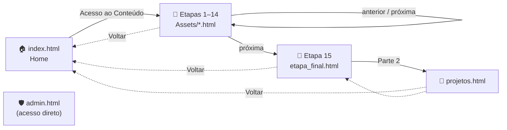

<div align="center">

# 🎓 Programa de Formação — HI Tecnologia

**Portal da jornada de formação técnica do Suporte Técnico da HI Tecnologia**


[🌐 Acessar o site](https://otavio7w7.github.io/Forma-o-HI/) ·
[⚡ Guia rápido](#-guia-rápido) ·
[🛠️ Manutenção](#️-como-fazer-manutenção) ·
[⚠️ Pontos de atenção](#️-pontos-de-atenção)

</div>

---

## 📌 Sobre o projeto

Site estático — **HTML, CSS e JS puros, sem build e sem frameworks** — que
reúne em uma página inicial as **15 etapas** do programa de formação. Cada
etapa abre uma página de conteúdo própria dentro de `Assets/`.

| ✅ O que o site tem | ❌ O que o site **não** tem |
|---|---|
| Home com as 15 etapas em cards (accordion) | Backend próprio ou CMS |
| Busca dentro do conteúdo das etapas | Etapa de build (`npm`, bundler etc.) |
| Progresso do aluno (local ou na nuvem) | Materiais hospedados no projeto |
| Modo escuro | CSS visual centralizado |
| Login de colaboradores e Painel ADM *(opcional, via Supabase)* | |

> 📎 Os materiais das aulas (PDFs, apostilas, provas, vídeos) ficam no
> **OneDrive / Google Drive / YouTube** da empresa e são apenas **linkados**
> pelas páginas.

---

## 📑 Sumário

1. [⚡ Guia rápido](#-guia-rápido)
2. [🚀 Rodando localmente](#-rodando-localmente)
3. [📁 Estrutura de pastas](#-estrutura-de-pastas)
4. [🧭 Como o site funciona](#-como-o-site-funciona)
5. [✨ Funcionalidades](#-funcionalidades)
6. [🗺️ Mapa Etapa → Arquivo](#️-mapa-etapa--arquivo)
7. [🧩 Padrão de código](#-padrão-de-código)
8. [🖼️ Imagens](#️-imagens)
9. [🛠️ Como fazer manutenção](#️-como-fazer-manutenção)
10. [⚠️ Pontos de atenção](#️-pontos-de-atenção)

---

## ⚡ Guia rápido

Para quem só quer editar algo e seguir em frente:

| Eu quero… | Onde mexer |
|---|---|
| ✏️ Mudar o texto de uma etapa | O arquivo da etapa em `Assets/` ([ver mapa](#️-mapa-etapa--arquivo)) |
| 🔗 Trocar um link de material ou prova | O `href` do botão na página daquela etapa |
| ➕ Adicionar uma etapa nova | [Criar uma nova etapa](#-criar-uma-nova-etapa-ex-etapa-16) |
| 🎨 Mudar cores / identidade visual | O bloco `<style>` de **cada** HTML |
| 📱 Ajustar responsividade ou modo escuro | `Assets/responsive.css` (compartilhado) |
| 🔐 Ligar o login e o Painel ADM | [Configurar o Supabase](#-login-do-colaborador-e-painel-adm) |

---

## 🚀 Rodando localmente

Não há nada para instalar. Basta servir a pasta:

```bash
# na raiz do projeto
python -m http.server 8000
# depois abra http://localhost:8000
```

> 💡 Dá para abrir o `index.html` com duplo clique, mas em `file://` o
> navegador bloqueia a **busca no conteúdo** (ela volta a filtrar só pelo
> texto dos cards). Use um servidor local para testar tudo.

---

## 📁 Estrutura de pastas

```text
Forma-o-HI/
├── index.html                       🏠 Home — índice das 15 etapas
├── README.md
├── supabase/
│   └── configuracao.sql             🗄️ SQL do login/progresso (rodar uma vez)
└── Assets/
    ├── responsive.css               📱 Responsividade + modo escuro + .etapa-nav (todas as páginas)
    ├── tema.js                      🌙 Alternância claro/escuro (todas as páginas)
    ├── progresso.js                 ✅ "Marcar etapa como concluída" + painel de progresso
    ├── busca-conteudo.js            🔎 Busca da home dentro do conteúdo das etapas
    ├── config-conta.js              🔑 URL e chave pública do Supabase (vazio = login desligado)
    ├── conta.js                     👤 Login do colaborador e envio do progresso
    ├── admin.html                   🛡️ Painel ADM (não linkado; só contas ADM)
    ├── fundamentos.html … radios.html   📘 Etapas 1 a 14 (ver mapa)
    ├── etapa_final.html             🏁 Etapa 15 — conclusão / desafios
    ├── projetos.html                🧪 "Parte 2" — projetos práticos
    └── Files/                       🖼️ Imagens das páginas (uma por página)
```

> [!WARNING]
> O **GitHub Pages diferencia maiúsculas de minúsculas**. Use os nomes de
> arquivo exatamente como estão — ex.: `HIscadapro.html`,
> `Files/HIscadaPRO.png`, `Files/SPDSW.PNG`, `gtonC_e_esc.html`.

---

## 🧭 Como o site funciona



1. **`index.html`** é a única página fora de `Assets/`. Ela tem:
   - um **Hero** de boas-vindas com imagem e vídeos de introdução;
   - a seção **Introdução ao Departamento**;
   - a seção **Fases da Formação** (a principal): barra de ferramentas
     (busca + "Abrir todas" / "Fechar todas") e um grid com **15 cards**.
     Cada card é um accordion em **CSS puro** (`<input type="checkbox">` +
     `<label>`) com o botão **"Acesso ao Conteúdo"**.
2. **Cada página de etapa é independente**: tem seu próprio `<head>`/`<style>`,
   mostra os materiais e a prova, e termina com a barra `.etapa-nav`
   (**Voltar** → `../index.html` + etapa anterior / próxima). A Etapa 1 não
   tem "anterior"; a Etapa 15 não tem "próxima".
3. **A Etapa 15** conclui o programa e linka para `projetos.html`, que ao
   final tem links de volta para a Etapa 15 e para a home.

---

## ✨ Funcionalidades

<details>
<summary><b>✅ Progresso do aluno</b> — <code>Assets/progresso.js</code></summary>

<br/>

- Carregado pela home e pelas 15 etapas.
- Cada etapa tem, acima da `.etapa-nav`, o botão **"Marcar etapa como
  concluída"** (`.btn-concluir[data-etapa="N"]`).
- A marcação fica no `localStorage` (chave `formacaoHI.etapasConcluidas`).
- A home mostra o painel **"X de 15 etapas concluídas"** com barra, botão
  **"Zerar progresso"** e o selo **✓ Concluída** nos cards.
- Sem login, o progresso vale **só para aquele navegador**.

</details>

<details>
<summary><b>🔎 Busca no conteúdo</b> — <code>Assets/busca-conteudo.js</code></summary>

<br/>

- Carregado só pela home.
- No primeiro uso da pesquisa, a home lê as páginas das 15 etapas (os
  blocos `.step` de cada uma).
- A partir de **2 letras**, mostra o painel `#buscaConteudo` com os passos
  que contêm o termo (ignora acentos e maiúsculas) e mantém visíveis os
  cards dessas etapas.
- Cada resultado abre a etapa já rolada até o título do passo (Text
  Fragment `#:~:text=`).
- **Não há índice para manter**: um passo novo entra na busca sozinho,
  desde que esteja dentro de um `.step` com `<h3>`.
- Em `file://` o navegador bloqueia a leitura e a busca filtra só pelo
  texto dos cards.

</details>

<details>
<summary><b>🌙 Modo escuro</b> — <code>Assets/tema.js</code></summary>

<br/>

- Carregado no `<head>` de todas as páginas, logo após o `responsive.css`,
  para aplicar o tema antes de a página aparecer.
- A escolha fica no `localStorage` (chave `hi-tema`).
- As cores do tema escuro ficam em `Assets/responsive.css`.

</details>

<details id="-login-do-colaborador-e-painel-adm">
<summary><b>🔐 Login do colaborador e Painel ADM</b> — <code>Assets/conta.js</code></summary>

<br/>

Carregado pela home, pelas 15 etapas, por `projetos.html` e por
`admin.html`. **Só funciona com `Assets/config-conta.js` preenchido** —
vazio, o site se comporta como no progresso local.

**Com o login ligado:**

- as páginas pedem login (e-mail + senha; aba "Criar conta" com nome);
- **"Esqueci minha senha"** envia o e-mail de redefinição do Supabase
  (`/auth/v1/recover`, com link de volta para a home). Ao abrir o link, o
  site pede a nova senha e já entra na conta;
- o progresso vai para a tabela `progresso` (etapas concluídas, última
  etapa aberta e último acesso). O que já estava no `localStorage` antes
  do primeiro login é **somado** à conta;
- `Assets/admin.html` lista todos os colaboradores (etapa atual, progresso,
  última etapa aberta, último acesso, exportar CSV) para contas cadastradas
  na tabela `admins`.

> 🛡️ A proteção dos dados é feita pelo **RLS do banco**
> (`supabase/configuracao.sql`), não por esconder a página.

**Passo a passo da configuração:**

1. Crie o projeto no [Supabase](https://supabase.com).
2. Rode `supabase/configuracao.sql` no SQL Editor.
3. Em **Authentication → Sign In / Providers → Email**, desligue
   **"Confirm email"**.
4. Em **Authentication → URL Configuration**, adicione a URL do site nas
   **Redirect URLs** (necessário para o "Esqueci minha senha").
5. Preencha `Assets/config-conta.js` com a **Project URL** e a chave
   **anon/publishable**.
6. Crie sua própria conta pelo site.
7. Rode o `insert` do final do SQL para virar **ADM**.

</details>

---

## 🗺️ Mapa Etapa → Arquivo

| # | Título | Arquivo (`Assets/`) | Imagem (`Files/`) |
|--:|---|---|---|
| 1 | Fundamentos da Automação Industrial | `fundamentos.html` | `Fundamentos.png` |
| 2 | Programação de CLPs no ambiente HIstudio | `HIstudio.html` | `HIstudio.png` |
| 3 | Portal de Telemetria — Supervisório em Nuvem | `telemetria.html` | `portal.png` |
| 4 | Programação de CLPs no ambiente SPDSW | `spdsw.html` | `SPDSW.PNG` |
| 5 | Banco de Dados PostgreSQL | `postgre_sql.html` | `Postgresql.png` |
| 6 | HIscada Pro — Sistema de Supervisão Local | `HIscadapro.html` | `HIscadaPRO.png` |
| 7 | Atendimento ao Cliente e Rotinas do Suporte | `atendimento_ao_cliente.html` | `AtendimentoAoCliente.png` |
| 8 | Protocolo MQTT para aplicações IoT | `mqtt.html` | `mqtt-logo.png` |
| 9 | Gateways GTON C SET e ESC717 | `gtonC_e_esc.html` | `GTON-C.png` |
| 10 | Modem Industrial GTON M e suas aplicações | `gtonM.html` | `GTON-M.png` |
| 11 | Gateway programável GTON P | `gtonP.html` | `GTON-P.jpg` |
| 12 | IHMs Touch Screen Weintek e IHM GTI5 | `ihm_touch.html` | `IHM_GTI5.png` |
| 13 | IHMs Alfanuméricas HI Tecnologia | `ihm_alfanumerica.html` | `MMI700.png` |
| 14 | Comunicação Wireless utilizando Rádios | `radios.html` | `radio.png` |
| 15 | Conclusão do programa e Desafios | `etapa_final.html` | `ParteFinal.jpg` |
| — | Projetos práticos (Parte 2) | `projetos.html` | `HILINO.png` |

---

## 🧩 Padrão de código

<details>
<summary><b>🏠 Página inicial</b> — <code>index.html</code></summary>

<br/>

- CSS com variáveis (`:root { --azul-hi; --laranja-hi; ... }`), grid
  responsivo (`.grid-container` com `auto-fit`/`minmax`) e cards com
  accordion em CSS puro.
- Um único `<script>` no final do `<body>` (IIFE) com 4 comportamentos:

| Comportamento | Elemento | O que faz |
|---|---|---|
| Busca | `#stageSearch` | Filtra os cards pelo texto (e, com `busca-conteudo.js`, pelo conteúdo das etapas) |
| Abrir / Fechar todas | `#openStages` / `#closeStages` | Marca/desmarca os checkboxes dos accordions visíveis |
| Voltar ao topo | `#backToTop` | Aparece após rolar 450px |
| Inicialização | `updateStages()` | Roda uma vez ao carregar |

</details>

<details>
<summary><b>📘 Páginas de etapa</b> — <code>Assets/*.html</code></summary>

<br/>

Todas seguem (com pequenas variações visuais) o mesmo esqueleto:

```html
<head>     <!-- <style> próprio, paleta quase idêntica à da home -->
<header>   <!-- título "HI Tecnologia" -->
<section class="hero">     <!-- título da etapa, texto e imagem Files/... -->
<section class="section">  <!-- blocos .step com botões .btn / .btn-secondary -->
<button class="btn-concluir" data-etapa="N">  <!-- marcar como concluída -->
<nav class="etapa-nav">    <!-- Voltar + anterior / próxima -->
<footer>   <!-- copyright -->
```

`etapa_final.html` e `projetos.html` seguem a mesma lógica, com layout
mais elaborado (várias seções, "voltar ao topo" próprio etc.).

</details>

---

## 🖼️ Imagens

Todas ficam em `Assets/Files/` — uma por página (ver a coluna **Imagem** do
[mapa](#️-mapa-etapa--arquivo)). Além delas:

| Arquivo | Uso |
|---|---|
| `Formacao.png` | Hero da `index.html` |
| `Aprendizado.jpg` | ⚠️ **Não utilizada** (arquivo órfão) |

---

## 🛠️ Como fazer manutenção

### ✏️ Editar texto ou links de uma etapa

Abra o arquivo da etapa em `Assets/` ([ver mapa](#️-mapa-etapa--arquivo)) e
edite os blocos `.step`. Não é preciso mexer na home.

### 🔗 Trocar links de conteúdo (OneDrive, Google Drive, vídeos)

Os materiais **não ficam no projeto** — são links
(`https://1drv.ms/...`, `https://docs.google.com/...`). Basta trocar a URL
no `href` da página da etapa; não é preciso subir arquivo novo.

### ➕ Criar uma nova etapa (ex.: Etapa 16)

- [ ] **1. Crie a página** — duplique uma etapa parecida em `Assets/`
  (ex.: `fundamentos.html` → `nova_etapa.html`) e ajuste `<title>`, o `<h1>`
  do hero, textos, links de conteúdo/prova e a imagem (adicione-a em
  `Assets/Files/`).
- [ ] **2. Ajuste a navegação** — confirme o **Voltar** (`../index.html`),
  o `data-etapa` do botão de concluir e os botões anterior/próxima na
  `.etapa-nav` da nova página **e das etapas vizinhas**.
- [ ] **3. Adicione o card na home** — em **Fases da Formação**, copie um
  bloco `<!-- ETAPA N --> ... <div class="card">...</div>` inteiro, cole
  antes do fechamento do `.grid-container` e ajuste:
  - `id` do checkbox (ex.: `id="etapa16"`, deve ser único);
  - `for` do `<label>` correspondente;
  - título `<h3>` e texto de `.card-content`;
  - `href` do botão → `Assets/nova_etapa.html`.
- [ ] **4. Atualize os textos fixos** — o contador **"15 etapas"** ao lado
  da busca e o **"0 de 15 etapas concluídas"** estão escritos no HTML.

> ✅ Não é preciso mexer no `<script>`: ele seleciona os cards via
> `.formation-tools ~ .grid-container .card`, então o novo card já é
> filtrado/aberto/fechado com os demais.

### 🎨 Estilo visual

Cada página tem seu próprio `<style>` com variáveis de cor parecidas
(`--azul-hi: #004A8F`, `--laranja-hi: #F26522` etc.). O único CSS
compartilhado é `Assets/responsive.css`, carregado por todas as páginas
depois dos estilos locais (responsividade, modo escuro e `.etapa-nav`).

> Para mudar cores/fontes de forma consistente, ainda é preciso editar o
> `<style>` de **cada** arquivo HTML.

---

## ⚠️ Pontos de atenção

| | Problema | Impacto |
|---|---|---|
| 🎨 | **CSS visual duplicado** em cada HTML | Mudança "global" (ex.: cor institucional) exige editar arquivo por arquivo |
| 🔠 | **Maiúsculas/minúsculas** nos nomes de arquivo | O GitHub Pages diferencia caixa — mantenha a grafia exata em `href`/`src` |
| 🖼️ | **Imagem órfã** `Assets/Files/Aprendizado.jpg` | Pode ser removida ou reservada para uso futuro |
| 🔢 | **Contador "15 etapas" fixo** no HTML | Não se atualiza ao adicionar/remover etapas (a busca recalcula, mas o valor inicial é manual) |
| 📝 | **Sem CMS** | Todo conteúdo é atualizado editando o HTML diretamente |

---

<div align="center">
<sub>Feito para o time de Suporte Técnico da HI Tecnologia 💙🧡</sub>
</div>
